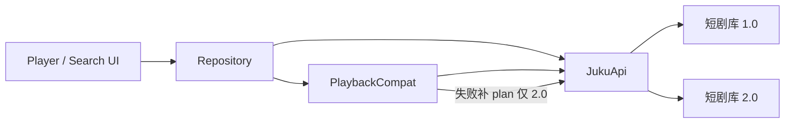

# JukuApp 1.0 / 2.0 双兼容大更新设计

日期：2026-10-07  
依据：`juku2.0/index.html` 对接交接 + 源码对比结论

## 结论（源码评估）

`JukuApp-源码-脱敏.zip` 与工作区 `JukuApp` **逐文件 MD5 一致**（49 个 Kotlin 文件完全相同）。
唯一差异是脱敏包去掉了 `juku-release.jks` / `keystore.properties` / `local.properties`，补了 `keystore.properties.example`。
**不是功能优化版**，无需“替换代码”；真正要做的大更新是 1.0/2.0 双兼容。

## 范围（按交接文档优先级）

| 优先级 | 项 | 做法 |
|--------|----|------|
| P0 | 播放 plan 兼容 | `hls/open` 失败时自动 `playback/plan` 再试一次；1.0 无感 |
| P1 | 搜索联想 | `GET api/ui/search/suggestions`，250ms 防抖，失败静默 |
| P1 | 兼容提示 | 解析 `video/audio_codec_unsupported` 等，播放页 Snackbar 一次 |
| — | 1.0 兼容 | 以上 2.0 接口全部 optional，404/异常不影响主流程 |

## 架构落点

- `data/remote/PlaybackCompat.kt`：取流兼容层（Repository 与 DownloadWorker 共用）
- `Dtos.kt` / `JukuApi.kt`：新增 plan、suggestions、兼容提示字段
- `DramaRepositoryImpl.searchSuggestions`：1.0 返回空列表
- `PlayerUiState.compatNotice`：提示一次性展示

## 保持不动

- `X-Juku-Viewer` / `Sec-Fetch-Site` / CookieJar
- 心跳 60–90s、progress `sequence` 单调递增
- 图片走 `/api/ui/image?url=`
- `fromHistory` 语义、`run` 为 Long

## 验证

1. `assembleDebug` 编译通过
2. 1.0 链路：直接 hls/open 成功，不调 plan
3. 2.0 链路：hls/open 失败自动 plan 重试
4. 搜索联想在 2.0 出现、1.0 静默
5. 兼容提示字段有值时 Snackbar 展示一次
